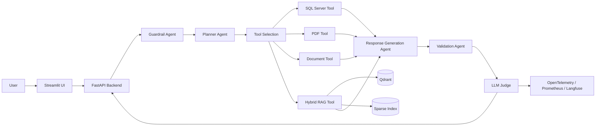
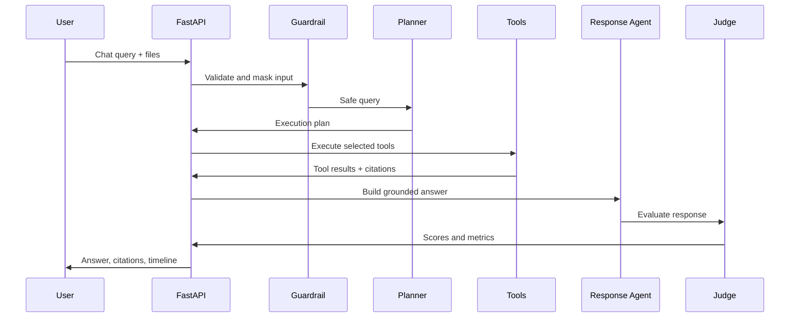

# Architecture

## System Architecture

## Multi-Agent Responsibilities

- Router Agent: derives the initial intent.
- Planner Agent: creates a tool execution plan.
- Tool Selection Agent: maps planned steps to concrete tools.
- SQL Agent: validates and executes safe SQL Server `SELECT` queries.
- PDF Agent: extracts text and summarizes PDF content, with OCR extension points.
- Document Agent: reads TXT, Markdown, DOCX, CSV, and Excel files.
- RAG Agent: performs ingestion, chunking, sparse retrieval, and vector-database integration.
- Response Generation Agent: synthesizes the final grounded answer.
- Validation Agent: checks tool outputs for failures and empty evidence.
- LLM Judge Agent: scores correctness, groundedness, faithfulness, completeness, relevance, and hallucination risk.
- Guardrail Agent: blocks injection attempts, masks PII, and validates outputs.
- Monitoring Agent: emits logs, metrics, traces, and evaluation results.

## Sequence

